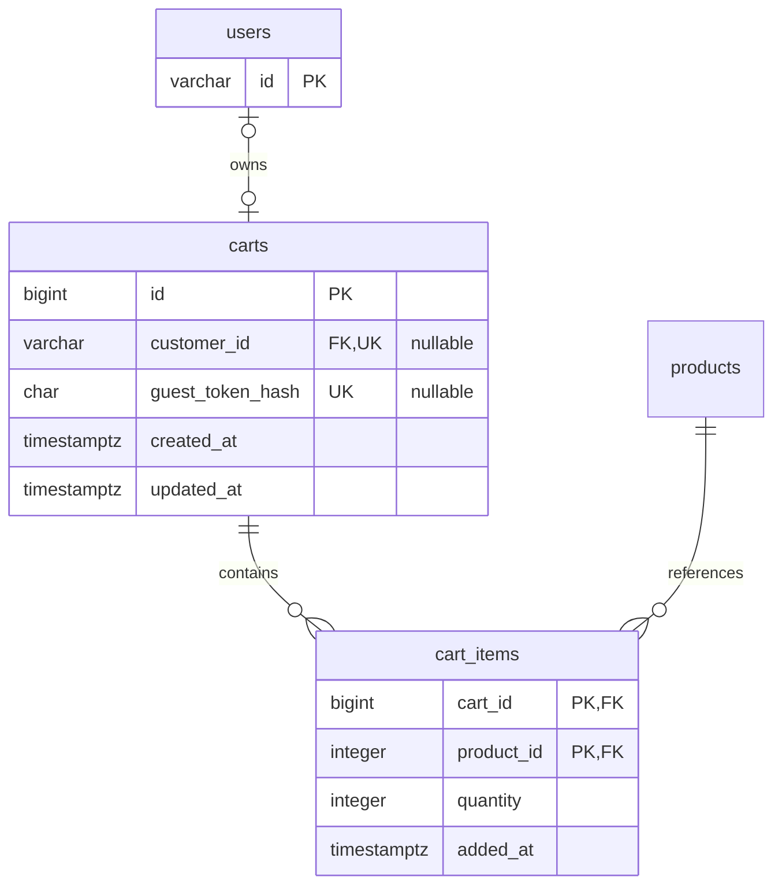

# Cart data model (SCRUM-48)

Owner: Mahmut. Reviewer: Ezgi. Parent story: SCRUM-18 (guest cart).
PostgreSQL 17; applied schema: `backend/db/migrations/005_create_carts.sql`.
The migration was introduced alongside Ezgi's SCRUM-49 API. This task documents
that existing model and verifies its database guarantees without creating the
same tables again or changing already-applied SQL.

## Relationships



Every cart has exactly one owner: a customer ID **or** a guest-token hash.
A customer or a guest-token hash can own at most one cart. A cart contains at
most one row for each product, using the composite primary key.

## Data dictionary

| Table / column         | Type        | Required    | Default                   | Rule                                                          |
| ---------------------- | ----------- | ----------- | ------------------------- | ------------------------------------------------------------- |
| carts.id               | BIGINT      | Yes         | Always-generated identity | Primary key.                                                  |
| carts.customer_id      | VARCHAR(60) | Conditional | NULL                      | Unique FK to users.id.                                        |
| carts.guest_token_hash | CHAR(64)    | Conditional | NULL                      | Unique SHA-256 hex token hash; never the cookie token itself. |
| carts.created_at       | TIMESTAMPTZ | Yes         | now()                     | Creation time.                                                |
| carts.updated_at       | TIMESTAMPTZ | Yes         | now()                     | Last cart change, maintained by the cart service.             |
| cart_items.cart_id     | BIGINT      | Yes         | None                      | FK to carts.id; part of primary key.                          |
| cart_items.product_id  | INTEGER     | Yes         | None                      | FK to products.id; part of primary key.                       |
| cart_items.quantity    | INTEGER     | Yes         | None                      | Strictly greater than zero.                                   |
| cart_items.added_at    | TIMESTAMPTZ | Yes         | now()                     | Time the line was inserted.                                   |

`carts_exactly_one_owner` rejects both-null and both-present ownership. PostgreSQL
uniqueness permits multiple NULL values, so unrelated guest and customer carts
can coexist. Foreign keys reject nonexistent owners, products and carts.

Deleting a cart cascades to its items. Deleting an otherwise unreferenced user
cascades to their cart and items. Deleting a product removes its cart lines;
the normal product API archives products to preserve order history instead.
Cart operations do not reserve or change stock. Checkout validates stock again
inside its transaction. Guest carts expire after 30 days without changes.

The database verifies that customer_id references a user; the API verifies that
the referenced user is a **customer**, not a staff role. Token generation/hashing,
the 100-line limit and stock-availability rules also belong to the service.
There is no price column in cart_items: current prices come from products;
purchase-time prices belong in order_items.

## Merge compatibility and sample data

Guest and customer carts use the same item structure. The existing SCRUM-52
service locks the carts, combines duplicate products, caps purchasable quantities
at stock, keeps unavailable lines visible, and deletes the consumed guest cart
inside one transaction. Its HTTP integration tests are in `cart-merge.test.js`.

An illustrative customer-cart insert, using an existing customer and product:

```sql
WITH cart AS (
    INSERT INTO carts (customer_id) VALUES ('CU-001')
    ON CONFLICT (customer_id) DO UPDATE SET updated_at = now()
    RETURNING id
)
INSERT INTO cart_items (cart_id, product_id, quantity)
SELECT cart.id, p.id, 2 FROM cart CROSS JOIN products p WHERE p.code = 'TK-001'
ON CONFLICT (cart_id, product_id) DO UPDATE SET quantity = EXCLUDED.quantity;
```

This example is documentation, not a production endpoint or a replacement for
Ceylin's catalogue seed data.

## Acceptance evidence

Run `node --test backend/test/cart-schema.test.js` from the repository root.
Run `npm run check` for the complete API/database suite, build and formatting.
Tests use fresh disposable PostgreSQL databases via `backend/test/postgres.js`.

| Requirement                                     | Evidence                                                    |
| ----------------------------------------------- | ----------------------------------------------------------- |
| Guest and customer carts                        | Migration owner constraint; existing cart API tests.        |
| Unique owner / product per cart                 | Direct SQL duplicate-owner and duplicate-line tests.        |
| Quantity > 0                                    | Invalid direct SQL updates leave a valid line unchanged.    |
| Foreign keys                                    | Missing customer/cart/product inserts fail.                 |
| Cleanup without affecting another cart or stock | Cart and customer cascade tests.                            |
| Merge-compatible transactions                   | Ownership-transfer rollback test plus existing merge suite. |

The new work is the schema specification and direct database acceptance tests.
API and merge implementation credit remains with the original SCRUM-49/52 work.

Local validation on 6 November 2026: all six new tests passed with a temporary
PostgreSQL 17.5 WASM (PGlite) fixture outside the project. Native embedded
PostgreSQL startup was blocked by the execution sandbox's shared-memory policy.
Run the standard test command on the team's PostgreSQL environment before merge;
the single-connection WASM run does not establish native multi-session locking.
