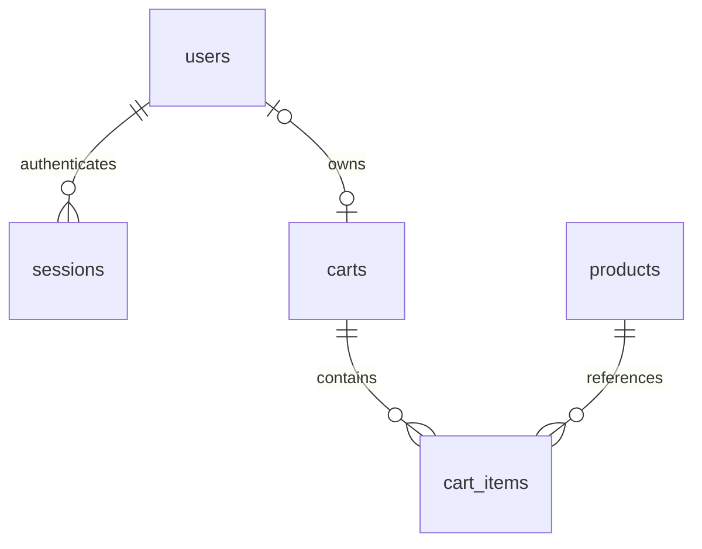

# Customer roles and cart merge rules (SCRUM-51)

Owner: Mahmut. Reviewer: Ezgi. Parent story: SCRUM-19 (keep the cart on login).
The existing `004_create_accounts_orders_reviews.sql` defines users and sessions;
the SCRUM-49/52 cart service implements guest ownership and transactional merges.
This task completes the four-role local demo data and documents/verifies those
contracts. It does not replace the original team's API implementation.

## Account dictionary and relationships

| users column  | PostgreSQL type | Rule                                                            |
| ------------- | --------------- | --------------------------------------------------------------- |
| id            | VARCHAR(60)     | Required primary key.                                           |
| name          | VARCHAR(160)    | Required, nonblank.                                             |
| email         | VARCHAR(254)    | Required, lowercase, unique. Signup normalizes email.           |
| home_address  | VARCHAR(500)    | Required; empty until the customer supplies it.                 |
| tax_id        | VARCHAR(40)     | Required; empty until supplied; local data uses placeholders.   |
| role          | VARCHAR(30)     | One of customer, sales-manager, product-manager, support-agent. |
| password_hash | TEXT            | Salted scrypt hash as salt:hash; no plaintext password column.  |
| created_at    | TIMESTAMPTZ     | Required, defaults to now().                                    |



Sessions reference users and store only hashed opaque tokens, with expiry.
Customer carts reference users; guests use a hashed cookie token instead.
Staff roles cannot use customer cart/checkout endpoints. Public registration
creates only customers; accepting a role from the browser cannot promote a user.
Account responses expose public profile fields, never password hashes.

## Four local test roles

`backend/src/seed.js` creates these accounts outside production at startup:

| Role            | Email                  | Local demo password |
| --------------- | ---------------------- | ------------------- |
| customer        | deniz@example.com      | CustomerDemo!24     |
| product-manager | manager@takistir.local | ManagerDemo!24      |
| sales-manager   | sales@takistir.local   | SalesDemo!24        |
| support-agent   | support@takistir.local | SupportDemo!24      |

Fresh databases receive all four roles. Existing development databases receive
only missing demo accounts; no existing password, role, profile, catalogue,
orders or stock is reset. A conflicting account ID or email is skipped rather
than changing that account's role. These are public local test credentials,
not a production provisioning flow. Sales/support workflows remain separate
tasks; their ability to authenticate does not implement those features.

The existing customer and Product Manager buttons still work. To try a new role,
enter its credentials into the login form. Restart the development API to run
the local seed backfill. Production startup does not call demo seeding.

## Guest-to-customer merge contract

The existing SCRUM-52 implementation in `backend/src/cart.js` follows these rules:

1. Only successful customer login/registration consumes that browser's guest cart.
   Failed login and staff login leave the guest cart untouched.
2. Both carts are locked and all item changes run inside one transaction.
3. A product in both carts gets the sum of its quantities. Purchasable lines
   are capped at available stock and reported in `data.cart.adjusted`.
4. Sold-out, archived or unpriced lines remain visible as unavailable and are
   excluded from the total. Cart contents do not reserve stock.
5. New lines above the 100-line limit are reported in `data.cart.skipped`.
6. The consumed guest cart and its items are removed; the cookie is cleared.
   Reusing the old cookie cannot apply the same quantities twice.
7. The customer cart remains account-owned across devices and logout. Logging
   out does not expose that cart to the next guest using the browser.
8. Guest carts older than the 30-day change window are not merged.

Current prices and stock come from the server. Checkout performs its own stock
checks and records purchase-time prices; the merge is not a purchase.

## Verification

From the repository root:

```sh
node --test backend/test/customer-roles.test.js backend/test/cart-merge.test.js
npm run check
```

The new role tests cover all four sign-ins, salted password storage, role/email
constraints, idempotent backfill, preserving existing account/catalogue data,
conflicting demo emails, staff cart restrictions and blocked staff self-signup.
The existing merge suite verifies retained quantities, stock capping, failed and
staff sign-ins, expired/replayed cookies, isolation and checkout after merging.

Review with Ezgi against SCRUM-19 before merging and closing SCRUM-51.

Local validation on 6 November 2026: the nine new account tests, fifteen existing
merge tests and fourteen PostgreSQL regression tests passed with a temporary
PostgreSQL 17.5 WASM fixture outside this project (38 tests total). Native embedded
PostgreSQL startup was blocked by the execution sandbox's shared-memory policy.
Run `npm run check` on the team's PostgreSQL environment before merge. The WASM
fixture serializes transactions and cannot establish native multi-session
locking/deadlock behavior.
