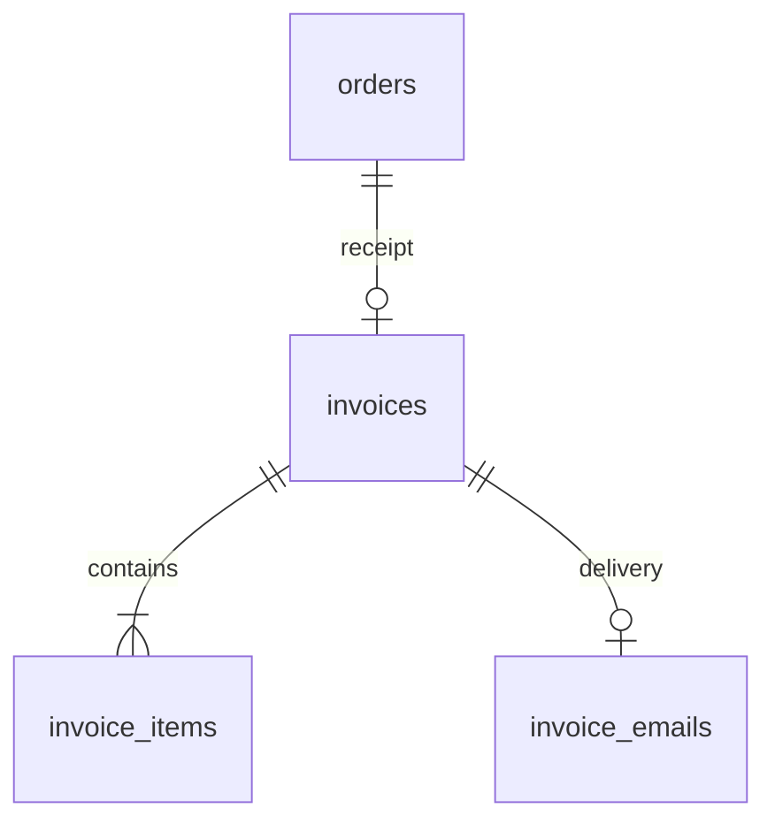

# Invoice records and email state — SCRUM-60

New checkouts capture the invoice and queue its email in the same transaction as
the order and inventory update. The existing invoice endpoint authorizes the
owner or an authorized manager, then uses the stored invoice values.
Purchase date, customer name/email/tax ID, delivery address, product code/name/image,
quantity, paid price, total and currency are captured for the invoice.



| Table          | Fields and constraints                                                                                                                           |
| -------------- | ------------------------------------------------------------------------------------------------------------------------------------------------ |
| invoices       | order_id PK/FK, unique number, customer_name, customer_email, tax_id, delivery_address, order_date, currency TRY, nonnegative total, captured_at |
| invoice_items  | (order_id, position) PK, unique product per invoice, product_code, product_name, product_image, positive quantity, nonnegative paid unit_price   |
| invoice_emails | order_id PK/FK, constrained status, nonnegative attempt_count, claim_token, lease_until, sent_at, updated_at                                     |

Migration 009 captures existing orders using their stored purchase items and the
customer profile available at upgrade time. It queues emails only for new
checkouts. Local accessory demo orders also receive snapshots, with email
queuing disabled. Invoice numbers follow the existing screen's TK-F format. Repeated
`storeInvoice(c, orderId)` calls preserve an existing snapshot.

Migration 008 creates mock payment records and 009 creates these invoice tables.
SCRUM-54's delivery-phone migration follows as 010. Merge PR #19 before PR #17.

## SCRUM-61 integration

PDF generation and email sending use the internal functions in
`backend/src/invoices.js`, after authorizing access to the order.

1. Run `claimInvoiceEmail(c, orderId)` inside a transaction and commit it.
   A successful claim returns the claim token and attempt count. Competing claims
   return null while its five-minute lease is active.
2. Read the stored snapshot with `loadInvoice(c, orderId)` and generate the PDF
   from those values. Use the snapshot's customer email as the recipient.
3. Send through the provider with the stable invoice number as its idempotency
   key. Then commit `finishInvoiceEmail(c, orderId, claimToken, true)` for success
   or `false` for a failed send.
4. Retry failed sends or expired leases. A new claim gets a fresh token. Stale
   completion calls return null. Sent emails cannot be claimed again.

The queue records actual sending results when the SCRUM-61 worker reports them.
The provider's idempotency key handles a process interruption after delivery but
before the database records success. Email operations update delivery state and
leave the purchase transaction independent of email retries.

## Accessory example

A customer purchasing two seed TK-001 accessories gets a 2500 TRY invoice and one
pending email row. Inspect the queue with this query.

```sql
SELECT i.number, i.total, i.currency, e.status, e.attempt_count
FROM invoices i JOIN invoice_emails e USING (order_id)
ORDER BY i.captured_at DESC;
```

## Verification

Eight tests in `backend/test/invoices.test.js` cover snapshot durability,
authorized access, checkout retries, single email claims, failed sends, expired
leases, stale workers, database constraints, rollback and upgrade of existing
accessory orders. They passed with a temporary PostgreSQL 17.5 PGlite fixture
outside the repository. Native PostgreSQL startup failed at shared-memory
allocation on this machine. Native multi-session validation and the team's
`npm run check` remain part of PR review.

The wider PGlite regression run passed 91 tests, followed by a successful frontend
build and formatting check. The native reconnection test was excluded because
the fixture provides an in-process database instead of a TCP PostgreSQL server.

Updated against main on 27 November 2026. All 101 selected regression tests passed
through the temporary PGlite fixture, followed by frontend build and formatting.
The native TCP reconnection test remains excluded from that fixture run.
