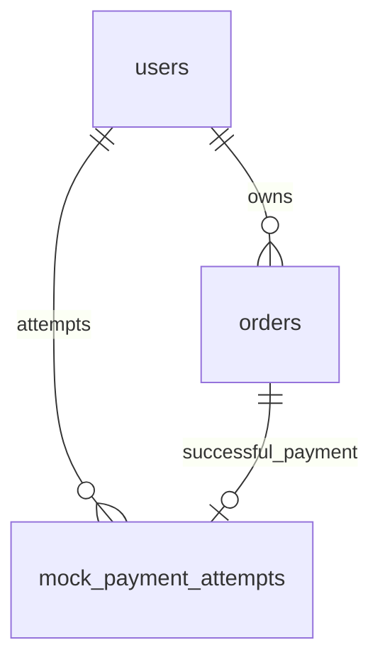

# Mock payment records — SCRUM-57

Checkout stores its successful mock payment in the same transaction as the order,
purchase-price snapshots and inventory reservation. Successful retries return the
existing order. SCRUM-58 can record failed results with the internal
`recordMockPayment(c, result)` query, using an authenticated customer ID and a
server-calculated attempted amount.



| Field        | Type                  | Contract                                             |
| ------------ | --------------------- | ---------------------------------------------------- |
| id           | UUID                  | Server-generated primary key                         |
| customer_id  | VARCHAR(60)           | Authenticated account, foreign key to users          |
| checkout_key | VARCHAR(100)          | Nonblank purchase key, shared across payment retries |
| attempt_key  | VARCHAR(100)          | Nonblank request key, unique per customer            |
| outcome      | VARCHAR(10)           | succeeded or failed                                  |
| order_id     | VARCHAR(40), nullable | Required for success, empty for failure              |
| amount       | NUMERIC(24,2)         | Nonnegative finite TRY amount                        |
| currency     | CHAR(3)               | TRY                                                  |
| created_at   | TIMESTAMPTZ           | Database timestamp                                   |

The composite foreign key ties a success to its actual customer, checkout key and
order. A partial unique index permits one success per customer/checkout.
Identical attempt retries return the existing result. Reusing an attempt key with
different data returns HTTP-style status 409 from the query helper. Successful
amounts are calculated from stored order items. Failed amounts come from the
trusted payment handler.

The storage helper accepts only these fields. Card numbers, expiry dates, security
codes, passwords and raw payment payloads have no database columns. Internal
queries require a transaction client. The handler commits a failed mock result
before returning a declined-payment response, so throwing that response inside
the transaction would roll back the audit record.

## Accessory example

Buy two TK-001 accessories through the existing customer checkout. With the seed
price of 1250 TRY, the payment record contains 2500 TRY. Use this read query to
inspect the stored result.

```sql
SELECT order_id, outcome, amount, currency, created_at
FROM mock_payment_attempts
WHERE customer_id = 'CU-001'
ORDER BY created_at DESC;
```

## Verification

`backend/test/mock-payments.test.js` covers successful checkout/retry pricing,
failed-attempt persistence, sensitive-field omission, key conflicts, owner and
checkout foreign keys, invalid outcomes/amounts and transaction rollback.
The six tests passed with a temporary PostgreSQL 17.5 PGlite fixture outside the
repository. Native PostgreSQL startup failed at shared-memory allocation on this
machine. Native multi-session validation and the team's `npm run check` remain
part of PR review.

The wider PGlite regression run passed 89 tests, followed by a successful frontend
build and formatting check. The native reconnection test was excluded because
the fixture provides an in-process database instead of a TCP PostgreSQL server.
