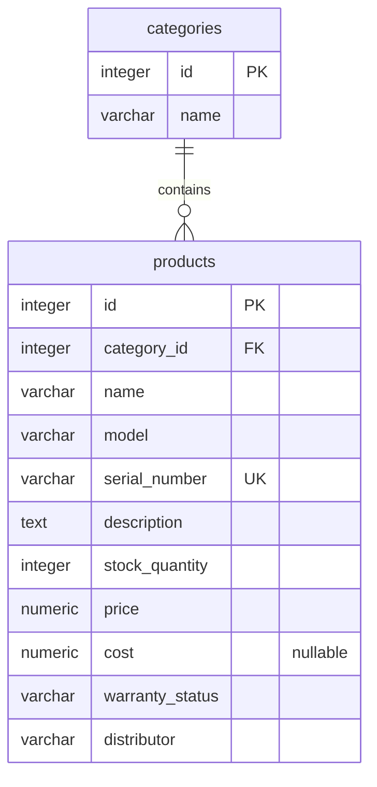

# Product and category schema (SCRUM-42)

Owner: Mahmut. Reviewer: Gence. Seed data: Ceylin (SCRUM-39).

This schema follows [SCRUM-42](https://watchstore.atlassian.net/browse/SCRUM-42),
Ceylin's agreed field names, and course requirements 1, 3, 7, 9 and 11.
It targets the PostgreSQL 17 setup on `SCRUM-39-database-setup`; that branch has
not yet been merged into `main`. The application uses Node.js and Express.

## Entity relationship diagram



Each product belongs to one category. A category can contain zero or more products.
Deleting a category with products is rejected; move or remove its products first.

## Data dictionary

### categories

| Column | PostgreSQL type | Nullable | Default  | Constraints / meaning                            |
| ------ | --------------- | -------- | -------- | ------------------------------------------------ |
| id     | INTEGER         | No       | Identity | Primary key; normally generated by the database. |
| name   | VARCHAR(100)    | No       | None     | Nonblank category name.                          |

### products

| Column          | PostgreSQL type | Nullable | Default  | Constraints / meaning                                         |
| --------------- | --------------- | -------- | -------- | ------------------------------------------------------------- |
| id              | INTEGER         | No       | Identity | Primary key; normally generated by the database.              |
| category_id     | INTEGER         | No       | None     | Foreign key to categories.id; indexed.                        |
| name            | VARCHAR(255)    | No       | None     | Nonblank product name.                                        |
| model           | VARCHAR(100)    | No       | None     | Nonblank model name or code.                                  |
| serial_number   | VARCHAR(100)    | No       | None     | Unique and nonblank; text preserves leading zeros.            |
| description     | TEXT            | No       | None     | Description text; empty text is permitted.                    |
| stock_quantity  | INTEGER         | No       | 0        | Must be at least zero.                                        |
| price           | NUMERIC(12, 2)  | No       | None     | Exact decimal price, nonnegative; NaN is rejected.            |
| cost            | NUMERIC(12, 2)  | Yes      | NULL     | Optional nonnegative unit cost; NaN is rejected.              |
| warranty_status | VARCHAR(100)    | No       | None     | Nonblank warranty information, such as "24 months" or "None". |
| distributor     | VARCHAR(255)    | No       | None     | Nonblank distributor information.                             |

Field names, unique serial numbers, category references, nonnegative stock/price
and nullable cost come from the task. Length limits, nonblank checks, default
stock, nonnegative cost and restricted category deletion are implementation
choices for reviewer approval. Category names are not required to be unique.
Warranty text is deliberately not an enum because accepted values are not yet
agreed. Serial numbers use PostgreSQL's ordinary text equality; the application
should agree a normalization policy before accepting user-entered identifiers.

The schema follows the task's product-level serial number and stock quantity.
If the team intends a separate serial number for each physical unit, that needs
a separate inventory-unit model rather than this catalogue-level identifier.

## Seed contract for Ceylin

Use `backend/db/seeds/` for seed scripts. Create categories first, capture their
IDs, then insert products. Each product must have a distinct serial number.
The following is a small, illustrative example, not the team's seed dataset:

```sql
WITH category AS (
    INSERT INTO categories (name) VALUES ('Necklaces') RETURNING id
)
INSERT INTO products (
    category_id, name, model, serial_number, description,
    stock_quantity, price, cost, warranty_status, distributor
)
SELECT id, 'Star Necklace', 'TK-KLY-001', 'TK-000001',
       'Star pendant accessory necklace.', 20, 349.90, NULL,
       '24 months', 'Example Distributor'
FROM category;
```

Use the agreed currency consistently; this schema does not add a currency column.
Money uses exact decimal values instead of floating point. Inputs with more than
two fractional digits are rounded by PostgreSQL to the column scale.

## Cost, stock and search behavior

- Keep unknown `cost` as NULL. Reports use 50% of the relevant sale price when
  cost is missing. An explicit zero must remain zero. Do not populate `cost` with
  a fixed half-price default, which could become stale when prices change.
- Allow zero-stock products to stay in the catalogue and search results. Cart and
  checkout services must prevent unavailable items from being purchased.
- The stock check prevents negative stored values. Checkout must still perform
  conditional stock updates in a transaction to handle competing purchases.
- Name/description search and popularity sorting are application work; this
  migration adds only the category index. No popularity value is invented here.

## Implementation and verification

The migration and reproducible SQL checks are documented in
[backend/db/README.md](../backend/db/README.md). This change creates database
tables; it does not implement product API endpoints or an ORM model layer.

Before marking the Jira task Done, integrate the database setup, run the checks
against the team's database, and have Gence review the migration and parent story.
